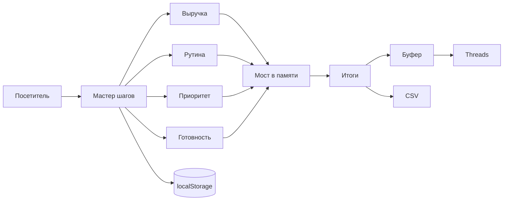

# Игра в бизнес

[](https://vite.dev/)
[](https://www.typescriptlang.org/)
[](https://vitest.dev/)
[](https://kartuznik.github.io/poket_game/)
[](LICENSE)

**Четыре пошаговых расчёта для малого бизнеса в браузере: выручка, рутина, приоритет и готовность. Без бэкенда и без регистрации.**

| Паспорт | |
| --- | --- |
| **Уровень** | Level 1 — линейные шаги, без агента, без LLM и без бэкенда |
| **Статус** | active — опубликовано на GitHub Pages |
| **Ценность** | Порядок потерь по времени и выручке и текст, который можно отправить автору |
| **Актуализация README** | 2026-10-25 · [история коммитов](https://github.com/kartuznik/poket_game/commits/main) |

Живой сайт: **https://kartuznik.github.io/poket_game/**

Операционного runbook в репозитории нет. Публикация описана в [`.github/workflows/deploy.yml`](.github/workflows/deploy.yml).

---

## О проекте

**Игра в бизнес** (репозиторий `poket_game`) — **portfolio / static MVP** для аудитории [@_kartuzzz](https://www.threads.com/@_kartuzzz) в Threads. Человек проходит четыре инструмента, видит свои цифры и забирает текст отчёта. Счёт идёт в браузере. Сервер автора цифры не получает.

### Что это

Для владельца малого бизнеса, который хочет понять порядок потерь на поздних ответах и ручной работе и с чего начинать автоматизацию. Регистрации нет. Первый заход не подставляет чужие цифры: поля пустые, «Дальше» выключена, пока шаг не заполнен. Черновик и подтверждённые ответы лежат в `localStorage` под ключом `poket_game:dossier:v1`. Подтверждённый снимок инструмента записывается только на последнем шаге. Если черновик или снимок уже есть, они восстанавливаются.

### Что умеет

- Четыре расчёта по шагам и экран с подтверждёнными цифрами.
- Черновик в браузере и восстановление уже пройденного визита.
- Копирование отчёта в буфер и открытие профиля в Threads.
- Скачивание таблицы CSV на устройство.
- Светлая и тёмная схема в браузере, отдельно от варианта оформления в адресе.

### Чего не умеет (честный scope)

- Нет бэкенда, базы, аккаунтов, аналитики и трекеров.
- Нет формы контактов. Имя, телефон и Telegram не спрашиваются и в текст отчёта не попадают.
- Сайт сам ничего не отправляет автору. Отчёт уходит, только если человек вставит его в сообщение.
- Нет мультипользовательности, ролей и общего кабинета.
- Нет оплаты, записи и SLA. Это не production-ready enterprise.
- Конкретные коммерческие цены живут **вне** git.

### Поведение при сбоях (graceful degradation)

- **`localStorage` недоступен или переполнен:** черновик остаётся в памяти вкладки, расчёт продолжается. После обновления страницы этот черновик пропадёт: на диск он не записался.
- **Битый JSON в `localStorage`:** запись пропускается, визит начинается с пустого досье. Страница не падает.
- **Буфер заблокирован:** сначала `navigator.clipboard`, затем запасной `document.execCommand('copy')`. Если оба пути не сработали, на экране тост «Буфер обмена заблокирован браузером…». Цифры остаются на странице, их можно выделить вручную.
- **Вкладка Threads не открылась:** копирование от этого не отменяется. Профиль можно открыть ссылкой [@_kartuzzz](https://www.threads.com/@_kartuzzz) в шапке.
- **Сеть пропала после загрузки:** уже открытая страница считает дальше. Первая загрузка с GitHub Pages без сети невозможна. Запасного хоста нет.

---

## Быстрый старт

```bash
git clone https://github.com/kartuznik/poket_game.git
cd poket_game
npm install
npm run dev
```

Нужен Node.js 22, как в workflow публикации. Открывать сайт можно и без клона: https://kartuznik.github.io/poket_game/

### Ролевые порты

| Роль | Порт |
| --- | --- |
| Сайт | своего порта нет: статические файлы на GitHub Pages |
| API, база, мониторинг | нет |

---

## Путь пользователя

1. **Калькулятор выручки под риском** (`#revenue-risk`) — 4 шага: обращения, доля поздних, конверсия, чек и доля возврата.
2. **Калькулятор рутины** (`#routine-calc`) — 4 шага: сценарий или свои цифры, операции, минуты, доля автоматизации и необязательная ставка.
3. **Диагностика «Что автоматизировать первым»** (`#priority-diag`) — один экран и шесть процессов. У каждого одна оценка «насколько это больно».
4. **Чек-лист готовности к автоматизации** (`#readiness-check`) — 3 шага по три пункта. «Да» / «Частично» / «Нет» заранее не выбраны.
5. **Ваш бизнес-аудит завершён** (`#audit-finish`) — итог по подтверждённым инструментам.

Вкладка **Итоги** (`#final-report`) показывает уже подтверждённое и в счётчик пути не входит.

На шаге 4 выручки карточка с деньгами скрыта, пока пуст хотя бы один из пяти ответов. Вместо неё просьба заполнить обращения и долю поздних ответов на предыдущих шагах.

### Выручка под риском

Крупная цифра — **потенциал возврата**. Над ней строка «Выручка под риском». Поле «Какую долю этих денег можно вернуть быстрым ответом» принимает 0–100% и двигает крупную цифру. Пока поле пустое, ползунок стоит на нуле, и это не считается ответом.

В досье хранится `lossFactor`: доля, которую считают потерянной (`0..1`). Доля возврата на экране — `1 - lossFactor`. Старое досье с `lossFactor: 0.3` читается как 70% возврата.

```text
Поздние обращения = обращения × доля поздних / 100
Выручка под риском = поздние обращения × конверсия / 100 × средний чек
Потенциал возврата = выручка под риском × доля возврата
В год = выручка под риском × 12
Один вовремя отвеченный диалог = средний чек × конверсия / 100
```

Режим **«Сценарное допущение»** подставляет один из четырёх сценариев. Это не статистика по России и не замер бизнеса. Режим **«Моя конверсия»** принимает 1–95%.

| Сценарий | Конверсия | Доля возврата на экране | `lossFactor` в досье |
| --- | --- | --- | --- |
| Бьюти, здоровье, локальные услуги | 30% | 50% | 0.5 |
| Товарный бизнес | 20% | 50% | 0.5 |
| Эксперты и обучение | 12% | 58% | 0.42 |
| B2B и сложные услуги | 8% | 63% | 0.37 |

Пример: 100 обращений, 35% поздних, конверсия 20%, чек 4 500 ₽, доля возврата 70%. Риск 31 500 ₽, потенциал возврата 22 050 ₽. В поля эти числа сами не подставляются.

### Рутина

```text
Часы в месяц = операции в неделю × минуты × 4,33 / 60
Экономия часов = часы × доля автоматизации
```

Рубли считаются только если указана ставка. Ноль в ставке — это ноль рублей, а не «ставка не указана».

### Приоритет

```text
Балл = частота × 0,4 + время × 0,3 + цена ошибки × 0,3
```

Шкала 1–5. Одна оценка «насколько это больно» записывается сразу в частоту, время и цену ошибки. В шапке результата — три верхних процесса, ниже полный список. При равенстве выше процесс с более дорогой ошибкой, затем с более высокой частотой.

### Готовность

«Да» = 1, «Частично» = 0,5, «Нет» = 0, максимум 9. Меньше 4 — «Рано», меньше 7 — «Закройте пробелы», 7 и выше — «Можно начинать».

---

## Возможности

### Для пользователя

- Пустые поля на первом заходе и понятный шаг, пока цифры не введены.
- Крупная цифра потенциала возврата, которая меняется вместе с ползунком.
- Резюме инструмента со ссылкой на его хэш и общий отчёт со ссылкой на сайт.
- Кнопка **«Обсудить эти цифры с Ефимом»**: копия отчёта в буфер и профиль [@_kartuzzz](https://www.threads.com/@_kartuzzz).
- Файл `business-game-report.csv`: разделитель `;`, UTF-8 с BOM, десятичная запятая. Колонка выручки называется «Доля возврата, %».
- **«Начать заново»** стирает досье в этом браузере после подтверждения.

### Для владельца

- Сервер владельца данные визита не собирает и не хранит.
- Цифры остаются в браузере человека. Владелец видит их, только если человек сам вставит отчёт в Threads.
- CSV тоже остаётся на устройстве человека.
- Отдельной админки, метрик и списка визитов нет.

---

## Архитектура



Каждый инструмент лежит в `src/tools/<id>/`: `calc.ts` считает, `view.ts` рисует шаги. `src/lib/bridge.ts` держит подтверждённые снимки только в памяти и отдаёт их на экран итогов. Долгое хранение — в досье, не в мосте. `src/components/wizard.ts` показывает один шаг, держит «Дальше» выключенной, пока шаг невалиден, и на последнем шаге завершает инструмент.

Светлая и тёмная схема хранится отдельно от параметра `theme` в адресе. `theme` — вариант оформления: `minimal`, `playful`, `editorial`.

### Поток данных

1. Человек открывает инструмент. Адрес вида `#revenue-risk?step=2` выбирает инструмент и шаг.
2. Мастер показывает один шаг и не пускает дальше, пока ответ невалиден.
3. Каждый ввод пишет черновик в `localStorage`. Подтверждённый снимок пишется только в конце инструмента.
4. `src/lib/bridge.ts` забирает подтверждённые снимки в память вкладки.
5. Экран итогов собирает отчёт из этих снимков.
6. Копирование кладёт текст в буфер. CSV скачивается как файл. Профиль Threads открывается отдельной вкладкой.
7. «Начать заново» очищает досье в этом браузере. Другие устройства не затрагиваются.

---

## Демо

Файлов в репозитории пока нет. Ожидаемые кадры:

| Плейсхолдер | Сценарий |
| --- | --- |
| `docs/demo/01-empty-start.png` | пустой первый шаг |
| `docs/demo/02-revenue-result.png` | потенциал возврата крупной цифрой |
| `docs/demo/03-incomplete-step.png` | заглушка на шаге 4 без предыдущих ответов |
| `docs/demo/04-audit-finish.png` | кнопка «Обсудить эти цифры с Ефимом» |

---

## Переменные окружения

| Переменная | Обязательна | Назначение |
| --- | --- | --- |
| — | — | Продукту переменные окружения не нужны. Секретов в репозитории нет |

Файл `.env` для запуска не требуется.

---

## Установка и деплой

### GitHub Pages

Пуш в `main` запускает [workflow](.github/workflows/deploy.yml): `npm ci`, проверка типов, тесты, `npm run build`, публикация `dist`. Ручной запуск — `workflow_dispatch`. Адрес: https://kartuznik.github.io/poket_game/

Docker Compose у проекта нет: серверного процесса нет, собирать контейнер не из чего.

### Локальный запуск

```bash
npm install
npm run dev
npm run typecheck
npm test
npm run build
npm run preview
```

`npm run build` сначала проверяет типы, затем собирает статику в `dist/`.

---

## Мониторинг

Prometheus, Grafana, команды `/health` и фонового опроса нет. Единственный сигнал публикации — зелёный прогон GitHub Actions.

Серверных данных нет, поэтому серверный backup не нужен. Копия визита живёт в браузере человека. Сохранить цифры можно отчётом в буфер или файлом CSV. «Начать заново» стирает досье только в этом браузере.

---

## Решение проблем

| Симптом | Что проверить |
| --- | --- |
| «Дальше» серая | шаг пустой или число вне границ |
| На шаге 4 нет карточки с деньгами | не заполнены предыдущие шаги: это заглушка |
| Тост про заблокированный буфер | браузер запретил копирование; цифры остаются на экране |
| После обновления страницы цифры пропали | `localStorage` был недоступен, черновик жил только в памяти вкладки |
| Доля возврата не совпала со старым визитом | в досье лежит `lossFactor`, на экране показан `1 - lossFactor` |
| Сайт не обновился после пуша | более поздний пуш отменяет предыдущий деплой в группе `pages` |
| Сборка падает по памяти | `NODE_OPTIONS=--max-old-space-size=256 npm run build` |

---

## FAQ

**Q: Это бесплатно?**
A: Да. Оплаты внутри продукта нет. Сайт на GitHub Pages открывается без аккаунта.

**Q: Как запустить у себя?**
A: `git clone`, `npm install`, `npm run dev`. Свой адрес на GitHub Pages — форк и тот же workflow. Отдельный сервер не нужен.

**Q: Можно ли использовать для клиентов?**
A: Код под MIT можно поднять у себя. Сопровождение, правка сценариев и отдельные условия — по запросу, вне этого репозитория. См. раздел про коммерческое использование.

**Q: Это production-ready enterprise?**
A: Нет. Это portfolio / static MVP: один статический сайт и расчёты в браузере.

**Q: Куда деваются введённые цифры?**
A: В `localStorage` браузера. Автору они попадают, только если человек сам отправит скопированный отчёт.

**Q: Нужна ли регистрация?**
A: Нет.

---

## Тестирование

```bash
npm run typecheck
npm test
npm run build
```

Тот же порядок выполняет workflow перед публикацией.

---

## Лицензирование и коммерческое использование

Базовая лицензия репозитория — **MIT** (см. [LICENSE](LICENSE)): код можно изучать, форкать и запускать self-hosted.

Коммерческие условия и редакции **Starter**, **Team** и **Custom** доступны **по запросу через контакт** (условия и коммерческие материалы — вне этого репозитория).

Кратко по составу возможностей (без коммерческих цифр):

| Редакция | Состав (ориентир) |
| --- | --- |
| **Community (MIT)** | Self-host статический сайт: четыре расчёта, CSV, копирование отчёта |
| **Starter** | Community + сопровождение однопользовательского демо |
| **Team** | Starter + правка сценариев и текстов по договорённости |
| **Custom** | Свой домен, дополнительные расчёты, локализованная документация под клиента |

Конкретные цены и коммерческие условия живут **вне** продуктового git.

## License

MIT — см. [LICENSE](LICENSE).

## Авторы

- [kartuznik](https://github.com/kartuznik) ([@_kartuzzz](https://www.threads.com/@_kartuzzz))
