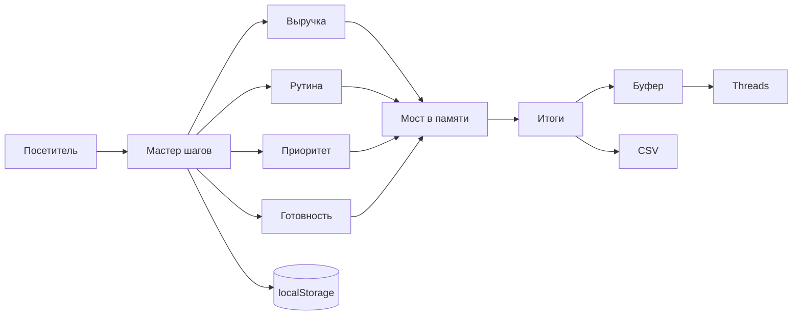

# Игра в бизнес

[](https://vite.dev/)
[](https://www.typescriptlang.org/)
[](https://vitest.dev/)
[](https://kartuznik.github.io/poket_game/)
[](LICENSE)

**Четыре пошаговых расчёта для малого бизнеса в браузере: выручка, рутина, приоритет и готовность. Без бэкенда и без регистрации.**

| Паспорт | |
| --- | --- |
| **Уровень** | Level 1 — линейные шаги, без агента, без LLM и без бэкенда |
| **Статус** | active — опубликовано на GitHub Pages |
| **Ценность** | Порядок потерь по времени и выручке и текст, который можно отправить автору |
| **Актуализация README** | 2026-11-14 · [история коммитов](https://github.com/kartuznik/poket_game/commits/main) |

Живой сайт: **https://kartuznik.github.io/poket_game/**

Операционные команды, деплой, мониторинг, хранение данных и rollback описаны в [`docs/RUNBOOK.md`](docs/RUNBOOK.md).

---

## О проекте

**Игра в бизнес** (репозиторий `poket_game`) — **portfolio / static MVP** для аудитории автора в Threads. Контакты и профили вынесены в [`docs/LINKS.md`](docs/LINKS.md). Человек проходит четыре инструмента, видит свои цифры и забирает текст отчёта. Счёт идёт в браузере. Сервер автора цифры не получает.

### Что это

Для владельца малого бизнеса, который хочет понять порядок потерь на поздних ответах и ручной работе и с чего начинать автоматизацию. Регистрации нет. Первый заход не подставляет чужие цифры: поля пустые, «Дальше» выключена, пока шаг не заполнен. Черновик и подтверждённые ответы лежат в `localStorage` под ключом `poket_game:dossier:v1`. Ключ не переименован в `v2`: иначе уже сохранённый визит в этом браузере пропал бы. Внутри JSON поле `version` равно 2, старая запись версии 1 читается и при следующем сохранении становится второй, подтверждённые цифры при этом остаются. Поле `niche` необязательное: нет поля или неизвестный id читаются как «своя», визит не теряется. Это закрыто тестом. Подтверждённый снимок инструмента записывается только на последнем шаге. Если черновик или снимок уже есть, они восстанавливаются.

### Что умеет

- Четыре расчёта по шагам и экран с подтверждёнными цифрами.
- Черновик в браузере и восстановление уже пройденного визита.
- Копирование отчёта в буфер и открытие профиля в Threads.
- Скачивание таблицы CSV и страницы HTML-отчёта на устройство.
- Светлая и тёмная схема в браузере, отдельно от варианта оформления в адресе.

### Чего не умеет (честный scope)

- Нет бэкенда, базы, аккаунтов, аналитики и трекеров.
- Нет формы контактов. Имя, телефон и Telegram не спрашиваются и в текст отчёта не попадают.
- Сайт сам ничего не отправляет автору. Отчёт уходит, только если человек вставит его в сообщение.
- Нет мультипользовательности, ролей и общего кабинета.
- Нет оплаты, записи и SLA. Это не production-ready enterprise.
- Конкретные коммерческие цены живут **вне** git.

### Поведение при сбоях (graceful degradation)

- **`localStorage` недоступен или переполнен:** черновик остаётся в памяти вкладки, расчёт продолжается. После обновления страницы этот черновик пропадёт: на диск он не записался.
- **Битый JSON в `localStorage`:** запись пропускается, визит начинается с пустого досье. Страница не падает.
- **Незнакомая версия досье:** ключ не перезаписывается. Следующее сохранение не стирает чужую запись пустым досье.
- **Буфер заблокирован:** сначала `navigator.clipboard`, затем запасной `document.execCommand('copy')`. Если оба пути не сработали, на экране тост «Буфер обмена заблокирован браузером…». Цифры остаются на странице, их можно выделить вручную.
- **Вкладка Threads не открылась:** копирование от этого не отменяется. Контакт автора указан в [`docs/LINKS.md`](docs/LINKS.md).
- **Сеть пропала после загрузки:** уже открытая страница считает дальше. Первая загрузка с GitHub Pages без сети невозможна. Запасного хоста нет.

---

## Быстрый старт

```bash
git clone https://github.com/kartuznik/poket_game.git
cd poket_game
npm install
npm run dev
```

Нужен Node.js 22, как в workflow публикации. Открывать сайт можно и без клона: https://kartuznik.github.io/poket_game/

### Ролевые порты

| Роль | Порт |
| --- | --- |
| Сайт | своего порта нет: статические файлы на GitHub Pages |
| API, база, мониторинг | нет |

---

## Путь пользователя

1. **Калькулятор выручки под риском** (`#revenue-risk`) — 4 шага: обращения, доля поздних, конверсия, чек и доля возврата.
2. **Калькулятор рутины** (`#routine-calc`) — 2 шага: выбор рутин, затем параметры, доля и ставка на одном экране.
3. **Диагностика «Что автоматизировать первым»** (`#priority-diag`) — один экран и шесть процессов. У каждого одна оценка «насколько это больно».
4. **Чек-лист готовности к автоматизации** (`#readiness-check`) — 3 шага по три пункта. «Да» / «Частично» / «Нет» заранее не выбраны.
5. **Ваш бизнес-аудит завершён** (`#audit-finish`) — итог по подтверждённым инструментам.

Вкладки называются «Выручка», «Рутина», «Приоритет» и «Готовность». Вкладка **Итоги** (`#final-report`) показывает уже подтверждённое и в счётчик пути не входит.

На шаге 4 выручки карточка с деньгами скрыта, пока пуст хотя бы один из пяти ответов. Вместо неё просьба заполнить обращения и долю поздних ответов на предыдущих шагах.

### Выручка под риском

Крупная цифра — **можно вернуть**. Над ней строка «Выручка под риском». Поле «Вернуть быстрым ответом» принимает 0–100% и двигает крупную цифру. Пока поле пустое, ползунок стоит на нуле, и это не считается ответом.

В досье хранится `lossFactor`: доля, которую считают потерянной (`0..1`). Доля возврата на экране — `1 - lossFactor`. Старое досье с `lossFactor: 0.3` читается как 70% возврата.

```text
Поздние обращения = обращения × доля поздних / 100
Выручка под риском = поздние обращения × конверсия / 100 × средний чек
Можно вернуть = выручка под риском × доля возврата
В год = выручка под риском × 12
Один вовремя отвеченный диалог = средний чек × конверсия / 100
```

Режим **«Сценарное допущение»** подставляет один из четырёх сценариев. Это не статистика по России и не замер бизнеса. Если в досье уже стоит ниша, в этом режиме активна пятая карточка «Ваша ниша: Кафе и еда — 25%» (название и процент этой ниши), четыре старых сценария не нажаты, под карточкой подпись-допущение. Нажатие старого сценария снимает нишу и включает его процент. На шагах выручки, пока ниша задана, видна полоска «Ниша: Кафе и еда». Режим **«Моя конверсия»** принимает 1–95% и карточки сценариев прячет.

| Сценарий | Конверсия | Доля возврата на экране | `lossFactor` в досье |
| --- | --- | --- | --- |
| Бьюти, здоровье, локальные услуги | 30% | 50% | 0.5 |
| Товарный бизнес | 20% | 50% | 0.5 |
| Эксперты и обучение | 12% | 58% | 0.42 |
| B2B и сложные услуги | 8% | 63% | 0.37 |

Пример: 100 обращений, 35% поздних, конверсия 20%, чек 4 500 ₽, доля возврата 70%. Риск 31 500 ₽, вернуть можно 22 050 ₽. В поля эти числа сами не подставляются.

Под крупной цифрой есть коридор. У каждого входа тег точности: точно (0), примерно (15%), наугад (35%). Нижняя граница умножает каждый множитель на `(1 − u)`, верхняя — на `(1 + u)`. Проценты после этого не выходят за 0–100. База коридора совпадает с тем, что можно вернуть. Если все теги «точно», фраза: «22 050 ₽/мес. Коридор схлопнулся: во всех входах вы уверены». Широкий коридор сам говорит, что входы ещё не точные. Блок называется «Насколько вы уверены в цифрах».

По умолчанию конверсия из сценарного допущения и доля возврата — «наугад», остальные входы — «примерно». Тег, который человек уже нажал, не сбрасывается при смене режима. Теги и выбранное покрытие бота лежат в черновике `revenueDraft` и после подтверждения — в снимке `revenue` (`uncertainty`, `botCoverage`). Старое досье без этих полей открывается как раньше.

На первом шаге выручки и на первом шаге рутины, если обращения, доля поздних и средний чек (или набор рутин) ещё пустые, стоит блок **«Цифр под рукой нет? Возьмите пример ниши.»** и кобальтовая кнопка **«Показать пример ниши»**. Она открывает то же меню. Если в черновике уже есть число, вместо блока тихая кнопка **«Подставить значения ниши»**. Вид выбирается один раз при открытии шага и не прыгает, пока человек печатает. Это не новый шаг мастера. Пять ниш и пункт **«Своя ниша»**. В выручку попадают обращения, доля поздних, средний чек, конверсия ниши и её доля возврата: кафе и бьюти 50%, школа 58%, фрилансер 30%, товарка 50%. Конверсия фрилансера остаётся 10%: 15 в той же строке — это обращения в месяц. Конверсия становится режимом «сценарное допущение», на кнопке написано название ниши, не один из четырёх старых сценариев, и тег конверсии ставится «наугад». Тег доли возврата при этом не меняется. Ниша записывается в досье до перерисовки шага конверсии, поэтому активна пятая карточка, а не «Бьюти 30%». Повторное нажатие старого сценария конверсии снимает подпись ниши. В рутину попадает набор из одной–трёх типовых рутин, а не старая пара «операции × минуты». Часы считаются из этих пресетов. Подпись-допущение стоит под конверсией и в шапке чек-листа, пока набор совпадает с нишей. Трём подставленным входам выручки и конверсии сразу ставится тег «наугад». Пока число совпадает с нишей, под полем стоит «значение ниши, сценарное допущение — замените своим замером». Своя правка числа подпись снимает, тег остаётся «наугад», пока его не сменят в блоке «Насколько вы уверены в цифрах». Тег «наугад» расширяет коридор по уже существующему правилу 35%.

| Ниша | Обращения | Доля поздних | Средний чек | Конверсия | Возврат | Рутины |
| --- | --- | --- | --- | --- | --- | --- |
| Кафе и еда | 180 | 40% | 900 ₽ | 25% | 50% | Приём заказов, Записи |
| Бьюти-услуги | 60 | 25% | 2 500 ₽ | 30% | 50% | Записи, Ответы на вопросы |
| Онлайн-школа и коуч | 40 | 45% | 12 000 ₽ | 12% | 58% | Ответы на вопросы, Перенос в таблицы |
| Фрилансер и консультант | 15 | 30% | 7 000 ₽ | 10% | 30% | Ответы на вопросы, Перенос в таблицы |
| Розница и товарка | 120 | 30% | 2 200 ₽ | 20% | 50% | Приём заказов, Ответы на вопросы |

Пустые поля заполняются сразу. Если число уже введено и оно другое, диалог показывает старое и новое. «Оставить как есть» не трогает ни числа, ни прошлую нишу. Повтор той же ниши при тех же числах ничего не пишет. «Своя ниша» убирает только подпись сценария. **«Вернуть свои цифры»** откатывает одну последнюю подстановку.

Ниша пишется в досье после успешной подстановки. План на неделю и перекрёстные выводы видят новые цифры только после подтверждения снимка на последнем шаге.

«Что если первый ответ — бот» спрашивает «Доля потерь, которую закроет бот». Кнопки: «3 из 10», «5 из 10», «7 из 10». Если доля ещё не выбрана, при открытии шага стоит «5 из 10», и превью считается сразу. Уже выбранные 3 или 7 из 10 не перезаписываются. Это оценка, не замер. Считает от выручки под риском и `lossFactor`:

```text
Сейчас = риск × lossFactor
С ботом = риск × (1 − C) × lossFactor
Предотвращено = C × сейчас
```

`C` в этом раунде только 0,3, 0,5 или 0,7. Своё число с клавиатуры — отдельная задача позже. Если в подтверждённой рутине процесс называется «Ответы на вопросы» и у него есть доля автоматизации, её можно подставить кнопкой. Освобождённые часы берутся из подтверждённого снимка рутины и на `C` не умножаются.

Резюме для Threads включает строку коридора и теги: человек публикует диапазон при своей точности, а не одну голую цифру. В CSV к выручке добавляются «Коридор от», «Коридор до» и «Насколько вы уверены в цифрах». Строки про бота появляются, когда доля уже записана в снимок. Активная кнопка сегмента залита `--accent-primary`, неактивная — прозрачная с серым контуром. Высота кнопки не меньше 44px.

### Рутина

```text
Часы в месяц = операции в неделю × минуты × 4,33 / 60
Экономия часов = часы × доля автоматизации
```

Рубли считаются только если указана ставка. Ноль в ставке — это ноль рублей. Пустая ставка на экране говорит: «Поставьте ставку, чтобы увидеть экономию в деньгах». В CSV и HTML строки «Итого экономия, ₽/мес» в этом случае нет.

Мастер из двух шагов: «Шаг 1 из 2» и «Шаг 2 из 2». Первый шаг — чек-лист типовых рутин. Можно отметить две или три. Часы складываются, доля автоматизации взвешивается по часам и округляется один раз в конце. Второй шаг собирает прежние операции, минуты, долю и ставку. Если список совпадает с рутинами ниши, на нём карточки только для чтения (операции, минуты и доля пресета) и одно поле ставки. Операции и минуты вводить не нужно. Если рутины выбраны вручную, на шаге 2 компактная таблица: строка на каждую рутину и два поля, операции и минуты, плюс общие доля и ставка. Пустая доля на таблице и на свободной строке показывает текст валидатора «Введите долю автоматизации от 0 до 100.». На нише поле доли скрыто, и этот текст не появляется. «Введу свои цифры» снимает чек-лист и оставляет одну свободную строку с этими двумя полями, долей и ставкой. «Своя ниша» снимает нишу и включает таблицу по выбранным рутинам. Старые адреса `#routine-calc?step=2`, `step=3` и `step=4` открывают шаг 2. Версия досье не меняется. «Изменить» с итогов открывает шаг 2. После подстановки ниши «Показать пример ниши» скрыта: видна «Вернуть свои цифры», если откат есть, иначе «Своя ниша». Бегунок и число доли идут с шагом 0,01, чтобы дробная доля не сбрасывалась. Пока ниша задана, на шагах рутины видна полоска «Ниша: Кафе и еда». Старое досье с одним `presetId` читается как список из одного элемента, сохранённые часы и деньги не пересчитываются. Кнопка «подставить из рутины» берёт долю только у элемента «Ответы на вопросы» и ничего не подставляет, если его нет.

### Приоритет

```text
Балл = частота × 0,4 + время × 0,3 + цена ошибки × 0,3
```

Шкала 1–5. Одна оценка «насколько это больно» записывается сразу в частоту, время и цену ошибки. На экране один список с баллами. Строгий максимум — лидер. Все шестёрки единиц — тихая доска: строки лидера нет, текст просит смотреть риск выручки и часы рутины. Два и больше процессов на максимуме от 2 и выше — ничья: одинаковые карточки с бейджем «одинаковый балл» и чипы «Что сгорит первым, если неделю не трогать?». Чип в покое залит поверхностью, не фоном страницы: контур, тень, высота не меньше 44px. Наведение смешивает 8% акцента. Нажатый чип — кобальтовый контур, подложка и галочка. Если деньги уже называют один процесс, этот чип выделен сразу, но выбор в черновик не пишется, пока человек не нажмёт. Причина тогда: «деньги разводят процессы» и сравнение двух сумм. «Вы выбрали, что сгорит первым» появляется только после клика. Если дефолта нет, под чипами строка «Дефолта нет: баллы равны, деньги процессы не разводят». Порядок массива рангом не является. Без выбора лидер не назначается, пока деньги не указывают на один процесс. Причина денежного выбора называет обе суммы и большую из них. Устаревший чип, который выпал из ничьей, лидером не становится. Если на финале только тихая доска и нет выручки с рутиной, тезис — сам тихий текст.

### Готовность

«Да» = 1, «Частично» = 0,5, «Нет» = 0, максимум 9. Меньше 4 — «Рано», меньше 7 — «Закройте пробелы», 7 и выше — «Можно начинать».

### Тексты

Сводка начинается с вывода, не с бренда. Смысл метрики живёт в её названии, а не в тултипе под блоком. Одна мысль — одно место: если цифра уже в тезисе или в карточке, блок ниже её не повторяет. Прикидка называется сценарным допущением. В текстах нет слов «оптимизация», «синергия» и «потенциал» без объекта: вместо них «вернуть», «закрыть», «замерить». Часы, дни и обращения склоняются через `formatCountWithNoun`: сначала округление до показанной точности, потом форма. 1,04 часа показывается как «1 час». 112 — «часов», потому что это та же форма, что у 12.

### Экран итогов

Над карточками один тезис. При подтверждённой выручке: «Риск выручки: **7 800 ₽**/мес. Можно вернуть: **1 560 ₽** при быстрых ответах.» Жирным только цифры. Нет выручки — тезис из часов, первого процесса или вердикта чек-листа. Над карточками блок «Приоритет» на всю ширину: имя слева, балл справа. Полоска 8px есть у каждого балла от 1, минимальная длина 20%, дальше по баллу до 100% на пятёрке. Кобальт у высшего балла, остальные полоски серые. Фраза «На 2 балла выше следующего» появляется только если отрыв не меньше 0,5 балла. Между приоритетом и карточками линия 1px. Дальше четыре карточки: «Под риском за месяц», «Можно вернуть за месяц», «Часы ручной работы», «Чек-лист из 9». В чек-листе кольцо 72px с дробью внутри и вердиктом под ним. Риск выручки остаётся числом. Готовность без кольца, когда инструмент не подтверждён, по-прежнему пишется как тире. Подтверждённый счёт по-прежнему может быть дробным, как `4,5/9`. Неподтверждённый инструмент — тире и «не замерено», не ноль. На 320px карточки стоят столбиком, с 375px сетка 2×2, с 640px один ряд. Над карточками строка «Сценарий: Кафе и еда» или «Сценарий: своя». Под карточками нет второго лида: блоки оставляют только то, чего в тезисе нет (коридор, дни и деньги, незакрытые пункты).

Дальше **«Перекрёстные выводы»**, не больше двух строк, в одном порядке. Правило молчит, если хотя бы одна его цифра ещё не подтверждена. Порог готовности — та же семёрка, что отделяет «Закройте пробелы» от «Можно начинать».

1. Риск от 20 000 ₽ и балл ниже 7: «Чек-лист ещё не закрыт, а выручка под риском уже заметная. Сначала нужен человек, который отвечает за канал.»
2. Рутина от 65 часов и первый процесс «Ответы на вопросы»: «Больше всего времени уходит на одинаковые ответы. Бот здесь окупается быстрее, чем в остальных процессах.»
3. Риск от 20 000 ₽ и балл 7 или выше: «По чек-листу старт уже возможен. Недельный план ниже — первый ход, не новый диагноз.»
4. Риск ниже 5 000 ₽ и рутина меньше 10 часов: «Пожара в цифрах нет. Достаточно повторить замер раз в месяц.»

Нет сработавших правил — блока нет. Дальше по экрану: прогресс, план на неделю, карточки инструментов с «Изменить», квитанция досье со штампом `Аудит пройден · ДАТА` и отрывным корешком `Корешок досье · HTML` (порог отрыва ~1/3 ширины, клавиши `Enter`/`ArrowRight` и сброс `Escape`, при `prefers-reduced-motion: reduce` — видимое затухание, после отрыва — строка статуса с кнопкой «Скопировать текст отчёта»), а рядом блок «Обсудить цифры с Ефимом»: главная кнопка Threads, контурная кнопка Telegram и текстовые ссылки «Скачать HTML», «Таблица .CSV», «Печать PDF». Контакты перечислены в [`docs/LINKS.md`](docs/LINKS.md). Шрифтовая система: `Prata` (заголовки и крупные цифры), `Onest` (интерфейс), `JetBrains Mono` (метаданные и строки досье), все шрифты лежат локально в `public/fonts/` под лицензией SIL OFL 1.1.

### Неделя и прогресс

На экране итогов, если подтверждён хотя бы один инструмент, блок **«Что сделать на этой неделе»** показывает ровно три шага. Пустой первый заход этот блок не рисует.

Порядок шагов. Если коридор выручки широкий, первый шаг просит уточнить самые неточные входы. Дальше пороги: риск от 20 000 ₽ в месяц — «Замерьте время первого ответа 5 дней подряд»; рутина от 65 часов в месяц — «Проведите хронометраж одного рабочего дня»; ответственный за Telegram не «да» — «Назначьте ответственного за Telegram-канал». Рекомендация процесса в план не копируется: она уже показана в приоритете. Если шагов меньше трёх, список добивается: «Запишите 10 реальных диалогов этой недели», «Неделю отвечайте только в одном канале», «Повторите замер через 7 дней».

Тот же список попадает в текст для Threads. Отдельной строки «Повторить замер до …» нет: шаг «Повторите замер через 7 дней» уже в плане. Короткая сводка для Telegram список не включает. При всех четырёх инструментах и назначенном лидере в ней ровно пять строк: тезис, ручная работа, первый процесс, чек-лист, ссылка. Если лидер не назначен (`quiet` или `open`), строки «Первым» нет. Перечня рутин в сводке нет. Бренда в сводке нет. Лимит по-прежнему шесть строк.

Блок **«Ваш прогресс»** стоит над недельным планом, когда есть снимок хотя бы суточной давности. От 1 до 27 дней фраза начинается с «С замера 12 марта» (день и месяц, без слова «месяц»). От 28 дней — «За 30 дней». Сравниваются риск выручки, часы рутины и балл готовности. Если цифра не сдвинулась или сдвиг округляется до нуля процентов, написано «без изменений», а не «0%». Линия рисуется только когда у одной метрики три точки и больше: сначала риск, иначе часы, иначе готовность. При двух точках остаётся текст. Та же фраза попадает в текст для Threads. Короткая сводка для Telegram её не включает.

Недельный план не повторяет рекомендацию процесса: она уже стоит в блоке приоритета. Три шага набираются из замера, порогов и коротких действий на неделю.

Подтверждение, которое меняет одну из этих трёх цифр, дописывает снимок в досье, не больше десяти. Одинаковые цифры новый снимок не создают. Старое досье без истории открывается как есть. «Начать заново» историю стирает вместе с досье.

### Файлы отчёта

`business-game-report-2026-10-31.csv` — UTF-8 с BOM, разделитель `;`, десятичная запятая, дата в имени — день по Москве. Первые три строки начинаются с `# `: название, дата генерации по Москве и ссылка на сайт. Дальше заголовок `Раздел;Показатель;Значение`. Каждая строка данных — три ячейки, раздел в первой: `Выручка;Итого риск, ₽;31500`, `Выручка;Можно вернуть, ₽;22050`, `Рутина;Часов в месяц;1,08`. Если выручка подтверждена, в том же разделе есть `Выручка;Ниша;Кафе и еда` или `Выручка;Ниша;своя`. Строка `Выручка;Режим;` пишет `Ниша: Кафе и еда`, когда конверсия взята из ниши, `Сценарное допущение` для одного из четырёх старых сценариев и `Моя конверсия` для своего процента. Без подтверждённой выручки строки ниши нет. Часы рутины записаны один раз. Если все теги точности «точно», одна строка `Выручка;Точка (все входы точные);22050`. Широкий коридор — две строки «Коридор от, ₽» и «Коридор до, ₽». Уверенность в цифрах — одна строка «Насколько вы уверены в цифрах». В приоритете есть строка состояния доски: «Лидер», «Лидер не выбран» или «Ничего не болит». Топ из порядка массива не пишется. Частота, время и цена ошибки пишутся только если они не равны между собой: иначе это та же цифра четыре раза. Несколько рутин дают группу на каждую и одну итоговую строку часов; у одной рутины строка часов по-прежнему одна. Строка «Итого экономия, ₽/мес» пишется только когда ставка есть. Пустую ячейку экспорт не оставляет. Ячеек по-прежнему три, разделитель `;`, десятичная запятая. «Итого баллов» не дублирует строку «Баллы». Колонок «Предыдущее» и «Изменение» в этой таблице нет.

Если есть снимок хотя бы суточной давности, под таблицей идёт секция `---История изменений---` со своими пятью колонками: `Раздел;Показатель;Значение;Предыдущее;Изменение`. Строки только у риска, часов и баллов. Первый проход эту секцию не пишет.

HTML скачивается как `business-game-report-2026-10-31.html`: дата в имени — день по Москве. Страница без внешних запросов. Ширина до 600px, на узком экране карточки встают в один столбец. `<title>` остаётся «Бизнес-аудит». В `<h1>` тезис, не бренд. Дата генерации один раз, в футере, рядом со ссылкой на расчёт. Дальше четыре крупные цифры с неразрывным пробелом в тысячах, таблица «Насколько цифра плавает» со строкой ниши (только при подтверждённой выручке), рутины с итогом, если их несколько, состояние доски приоритета без фальшивой тройки, фраза прогресса и линия (только от трёх точек), план на неделю. Тихая доска и открытая ничья план не кормят: если других инструментов нет, блока недели нет. Светлая и тёмная схема следуют системе. Печать держит карточки и план целиком (`break-inside: avoid`) и не начинает план с новой страницы. Кнопка «Скачать PDF» открывает этот файл и системный диалог печати.

---

## Возможности

### Для пользователя

- Пустые поля на первом заходе и понятный шаг, пока цифры не введены.
- Крупная цифра «можно вернуть», которая меняется вместе с ползунком.
- Резюме инструмента со ссылкой на его хэш и общий отчёт со ссылкой на сайт.
- Под заголовком **«Обсудить цифры с Ефимом»** кнопка Threads: копия отчёта в буфер и профиль автора. Контакт указан в [`docs/LINKS.md`](docs/LINKS.md).
- Кнопка Telegram: короткая сводка не длиннее 6 строк. При четырёх инструментах и назначенном лидере ровно пять: тезис, ручная работа, первый процесс, чек-лист, ссылка на сайт. Без лидера строки «Первым» нет. Копируется в буфер и открывает контакт автора из [`docs/LINKS.md`](docs/LINKS.md). Это формат для мессенджера, не отдельный бот.
- Отрывной корешок **«Корешок досье · HTML»** (перетягивание вправо на ~1/3 ширины, клик, `Enter` или `ArrowRight` для сохранения HTML-досье, с запасной кнопкой «Скопировать текст отчёта») и текстовые ссылки **«Скачать HTML»**, **«Таблица .CSV»** и **«Печать PDF»** на экране итогов. CSV описан в разделе «Файлы отчёта»: три колонки в основной таблице, только тройка процессов, история отдельной секцией на пять колонок. HTML открывается в браузере. PDF — тот же HTML через системный диалог печати.
- **«Начать заново»** стирает досье в этом браузере после подтверждения.

### Для владельца

- Сервер владельца данные визита не собирает и не хранит.
- Цифры остаются в браузере человека. Владелец видит их, только если человек сам вставит отчёт в Threads.
- CSV и HTML тоже остаются на устройстве человека.
- Отдельной админки, метрик и списка визитов нет.

---

## Архитектура



Каждый инструмент лежит в `src/tools/<id>/`: `calc.ts` считает, `view.ts` рисует шаги. `src/lib/bridge.ts` держит подтверждённые снимки только в памяти и отдаёт их на экран итогов. Долгое хранение — в досье, не в мосте. `src/components/wizard.ts` показывает один шаг, держит «Дальше» выключенной, пока шаг невалиден, и на последнем шаге завершает инструмент. Фокус после перехода встаёт на первое видимое поле: скрытое поле и поле внутри скрытого блока пропускаются, поэтому на шаге 2 ниши фокус попадает на ставку. Enter и Go в числовом поле или текстовой области пересчитывают шаг и идут дальше, только если он валиден. На последнем шаге это «Показать расчёт», а не переход в следующий инструмент. Shift+Enter не перехватывается. На валидном последнем шаге поля скрыты, над цифрой стоит кнопка «Изменить цифры» на всю ширину. Она возвращает поля этого же шага, и основная кнопка снова читается «Показать расчёт».

Светлая и тёмная схема хранится отдельно от параметра `theme` в адресе. `theme` — вариант оформления: `minimal`, `playful`, `editorial`.

### Поток данных

1. Человек открывает инструмент. Адрес вида `#revenue-risk?step=2` выбирает инструмент и шаг.
2. Мастер показывает один шаг и не пускает дальше, пока ответ невалиден.
3. Каждый ввод пишет черновик в `localStorage`. Подтверждённый снимок пишется только в конце инструмента.
4. `src/lib/bridge.ts` забирает подтверждённые снимки в память вкладки.
5. Экран итогов собирает отчёт из этих снимков.
6. Копирование кладёт текст в буфер. CSV скачивается как файл. Профиль Threads открывается отдельной вкладкой.
7. «Начать заново» очищает досье в этом браузере. Другие устройства не затрагиваются.

---

## Демо

Файлов в репозитории пока нет. Ожидаемые кадры:

| Плейсхолдер | Сценарий |
| --- | --- |
| `docs/demo/01-empty-start.png` | пустой первый шаг |
| `docs/demo/02-revenue-result.png` | крупная цифра «можно вернуть» |
| `docs/demo/03-incomplete-step.png` | заглушка на шаге 4 без предыдущих ответов |
| `docs/demo/04-audit-finish.png` | кнопки Threads и Telegram; контакты — в [`docs/LINKS.md`](docs/LINKS.md) |

---

## Переменные окружения

| Переменная | Обязательна | Назначение |
| --- | --- | --- |
| — | — | Продукту переменные окружения не нужны. Секретов в репозитории нет |

Файл `.env` для запуска не требуется.

---

## Установка и деплой

### GitHub Pages

Пуш в `main` запускает [workflow](.github/workflows/deploy.yml): `npm ci`, проверка типов, тесты, `npm run build`, публикация `dist`. Ручной запуск — `workflow_dispatch`. Адрес: https://kartuznik.github.io/poket_game/. Пошаговые команды и rollback — в [`docs/RUNBOOK.md`](docs/RUNBOOK.md).

Docker Compose у проекта нет: серверного процесса нет, собирать контейнер не из чего.

### Локальный запуск

```bash
npm install
npm run dev
npm run typecheck
npm test
npm run build
npm run preview
```

`npm run build` сначала проверяет типы, затем собирает статику в `dist/`.

---

## Мониторинг

Prometheus, Grafana, команды `/health` и фонового опроса нет. Единственный сигнал публикации — зелёный прогон GitHub Actions. Проверки и действия при сбое описаны в [`docs/RUNBOOK.md`](docs/RUNBOOK.md).

Серверных данных нет, поэтому серверный backup не нужен. Копия визита живёт в браузере человека. Сохранить цифры можно отчётом в буфер или файлом CSV. «Начать заново» стирает досье только в этом браузере.

---

## Решение проблем

| Симптом | Что проверить |
| --- | --- |
| «Дальше» серая | шаг пустой или число вне границ |
| На шаге 4 нет карточки с деньгами | не заполнены предыдущие шаги: это заглушка |
| Тост про заблокированный буфер | браузер запретил копирование; цифры остаются на экране |
| После обновления страницы цифры пропали | `localStorage` был недоступен, черновик жил только в памяти вкладки |
| Доля возврата не совпала со старым визитом | в досье лежит `lossFactor`, на экране показан `1 - lossFactor` |
| Сайт не обновился после пуша | более поздний пуш отменяет предыдущий деплой в группе `pages` |
| Сборка падает по памяти | `NODE_OPTIONS=--max-old-space-size=256 npm run build` |

---

## FAQ

**Q: Это бесплатно?**
A: Да. Оплаты внутри продукта нет. Сайт на GitHub Pages открывается без аккаунта.

**Q: Как запустить у себя?**
A: `git clone`, `npm install`, `npm run dev`. Свой адрес на GitHub Pages — форк и тот же workflow. Отдельный сервер не нужен.

**Q: Можно ли использовать для клиентов?**
A: Код под MIT можно поднять у себя. Сопровождение, правка сценариев и отдельные условия — по запросу, вне этого репозитория. См. раздел про коммерческое использование.

**Q: Это production-ready enterprise?**
A: Нет. Это portfolio / static MVP: один статический сайт и расчёты в браузере.

**Q: Куда деваются введённые цифры?**
A: В `localStorage` браузера. Автору они попадают, только если человек сам отправит скопированный отчёт.

**Q: Нужна ли регистрация?**
A: Нет.

---

## Тестирование

```bash
npm run typecheck
npm test
npm run build
```

Тот же порядок выполняет workflow перед публикацией.

---

## AI-инструменты

Приложение собрано в Cursor agent. Координацию вёл ассистент Qwen. Независимое QA — Grok.

---

## Лицензирование и коммерческое использование

Базовая лицензия репозитория — **MIT** (см. [LICENSE](LICENSE)): код можно изучать, форкать и запускать self-hosted.

Коммерческие условия и редакции **Starter**, **Team** и **Custom** доступны **по запросу через контакт** (условия и коммерческие материалы — вне этого репозитория).

Кратко по составу возможностей (без коммерческих цифр):

| Редакция | Состав (ориентир) |
| --- | --- |
| **Community (MIT)** | Self-host статический сайт: четыре расчёта, CSV, копирование отчёта |
| **Starter** | Community + сопровождение однопользовательского демо |
| **Team** | Starter + правка сценариев и текстов по договорённости |
| **Custom** | Свой домен, дополнительные расчёты, локализованная документация под клиента |

Конкретные цены и коммерческие условия живут **вне** продуктового git.

## License

MIT — см. [LICENSE](LICENSE).

## Авторы

Контакты и профили автора перечислены в [`docs/LINKS.md`](docs/LINKS.md).
